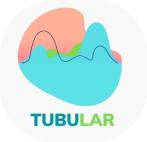
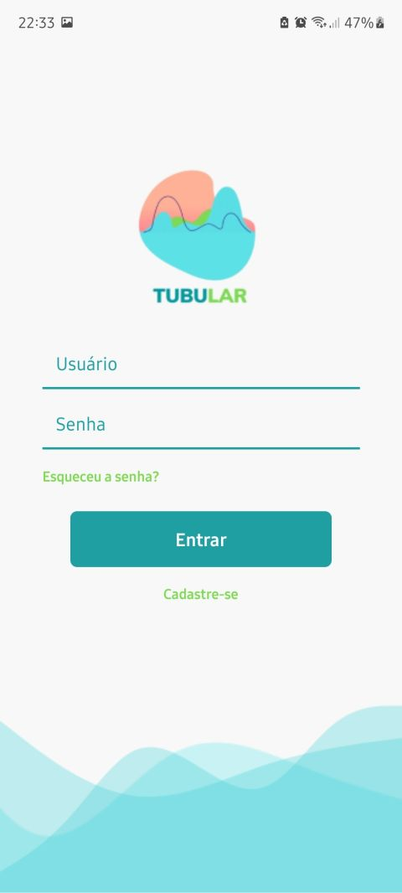
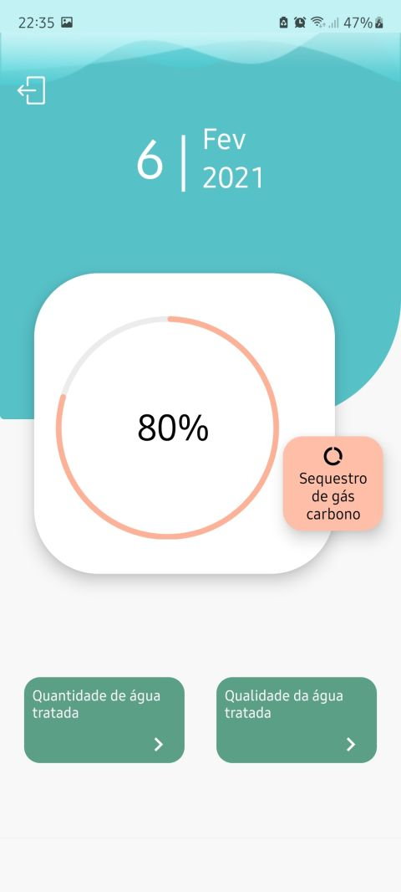
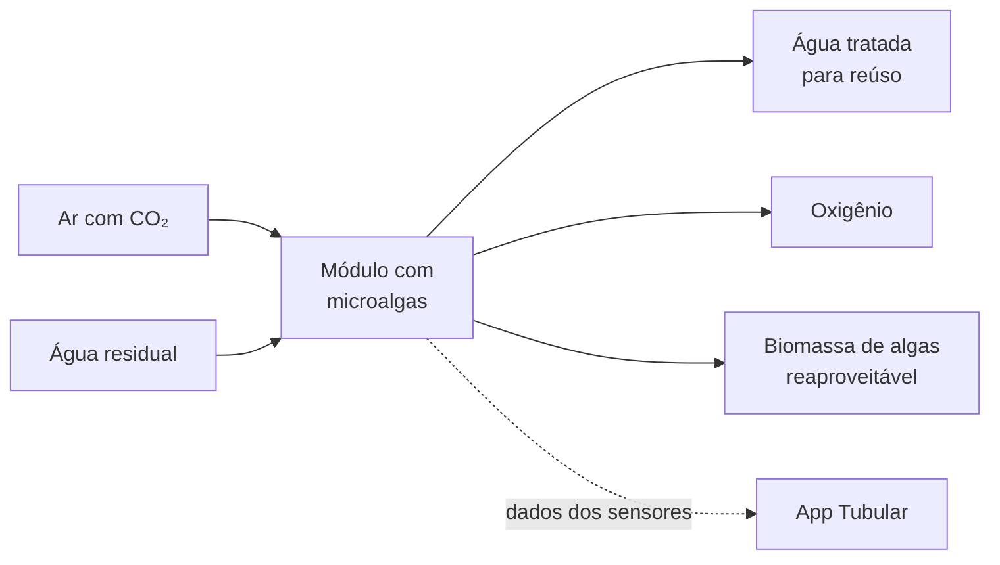
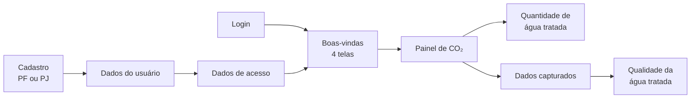

<div align="center">



# Tubular

Aplicativo mobile para acompanhar um módulo com microalgas que trata água para reúso e, ao mesmo tempo, captura CO₂ do ar.<br>
Criado em um hackathon com tema de meio ambiente, em 2021.


&nbsp;&nbsp;&nbsp;


<sub>Login e painel de sequestro de carbono rodando em um celular Android</sub>

</div>

## Sobre

O Tubular foi pensado como uma startup de tecnologia ambiental. A proposta da equipe era um módulo com **microalgas**, instalado no estabelecimento do cliente, que resolveria dois problemas de uma vez:

- **Tratar a água para reúso:** para crescer, as microalgas consomem os nutrientes da água residual, como nitrogênio e fósforo. Assim, a água fica mais limpa.
- **Capturar CO₂ do ar:** na fotossíntese, as algas absorvem gás carbônico e liberam oxigênio.

A biomassa de algas gerada no processo ainda pode ser reaproveitada como biofertilizante ou como matéria-prima para biocombustíveis e bioplásticos. Pesquisas e startups pelo mundo usam o mesmo princípio, muitas vezes em fotobiorreatores tubulares.



O aplicativo é o painel do cliente. Nele, o cliente vê quanto CO₂ o módulo capturou e a quantidade e a qualidade da água tratada, comparadas ao padrão exigido pela norma. A apresentação do app também previa dicas para reaproveitar as algas.

Eu desenvolvi o aplicativo, da navegação aos gráficos.

## Funcionalidades

- **Cadastro em etapas:** escolha entre pessoa física ou jurídica, preenchimento dos dados (CPF, ou CNPJ e razão social) e criação do acesso.
- **Login** com links para recuperar a senha e para se cadastrar.
- **Boas-vindas** em quatro telas deslizáveis que apresentam o serviço.
- **Painel de CO₂:** gráfico circular com o percentual de sequestro de carbono e a data do dia.
- **Quantidade de água tratada:** gráfico de pizza (eficiência da reutilização × capacidade instalada) que mostra o percentual ao tocar na fatia, evolução da qualidade por kit em um gráfico de área e filtro por mês e ano.
- **Qualidade da água tratada:** formulário com os dados medidos (turbidez, pH, oxigênio dissolvido, DBO e carbono) e gráficos que comparam a água tratada com a qualidade exigida pela norma.

## Fluxo de telas



## Tecnologias

| Para | Uso |
|---|---|
| Base | React Native 0.63 e React 16 |
| Navegação | React Navigation 5 (pilha e abas deslizáveis) |
| Gráficos | react-native-svg, react-native-svg-charts e d3-shape |
| Interface | react-native-vector-icons, react-native-dropdown-picker e react-native-responsive-screen (tamanhos proporcionais à tela) |
| Qualidade de código | ESLint (padrão Airbnb) e Prettier |

## Estrutura

```
src/
├── assets/images/   # logo, ilustrações e ondas do layout
├── components/      # botões, campos, containers e telas de boas-vindas reutilizáveis
├── routes/          # pilhas de navegação e abas
└── screens/         # uma pasta por tela, com index.js (componente) e styles.js (estilos)
```

## Como rodar

Pré-requisitos da época: Node 12 ou 14, Yarn 1, JDK 8 ou 11 e Android Studio com um emulador (ou um celular com depuração USB).

```bash
git clone https://github.com/talialino/TUBULAR.git
cd TUBULAR
yarn
yarn start      # inicia o Metro
yarn android    # em outro terminal: instala e abre o app
```

> O React Native 0.63 é de 2020. Em máquinas com ferramentas mais novas, pode ser preciso usar versões antigas do Node e do JDK.

## Status e aprendizados

É um protótipo de hackathon: as telas, a navegação e os gráficos estão prontos, mas os números exibidos são simulados. A próxima etapa seria ligar o app aos sensores do módulo por meio de uma API.

A ideia não seguiu como startup. O app dependia do protótipo físico, e a equipe não encontrou uma forma de monetizar um produto cujo papel era monitorar esse equipamento. Para mim, ficaram a experiência de construir um app com várias telas em poucos dias e a prática com gráficos em SVG no React Native.

## Autora

Feito por **Talia Lino**: [LinkedIn](https://www.linkedin.com/in/talia-lino-de-oliveira/) · [GitHub](https://github.com/talialino)
